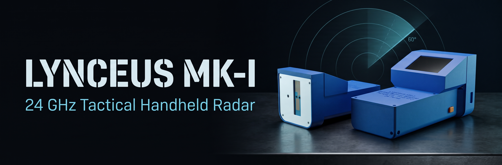
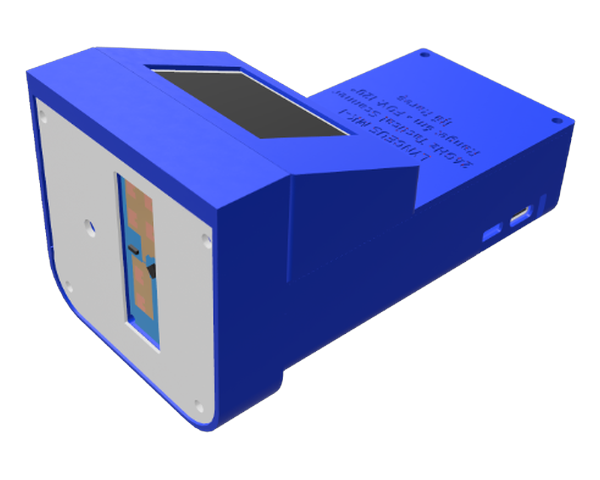
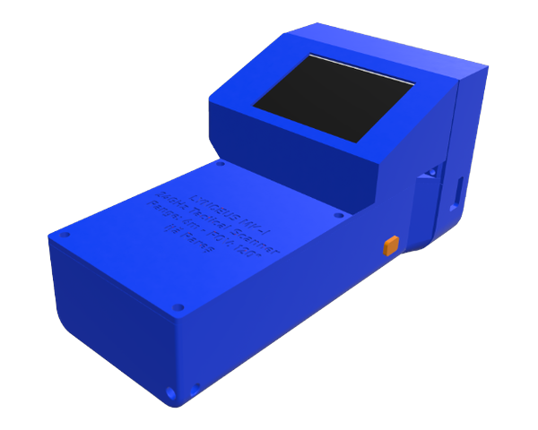
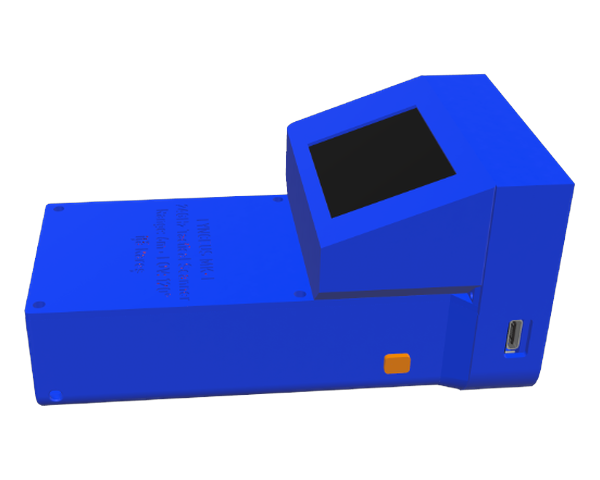

<p align="center">
  
</p>

<p align="center">
  <a href="#2-conexiuni-hardware-pinout"></a>
  <a href="platformio.ini"></a>
  <a href="#2-conexiuni-hardware-pinout"></a>
  <a href="#6-listă-de-componente-bill-of-materials---bom"></a>
  <a href="CAD/"></a>
</p>

# Lynceus MK-I — ESP32-S3 + HLK-LD2450 + ST7789

**Lynceus MK-I** este un radar portabil în unde milimetrice (24 GHz FMCW) construit în jurul unui **ESP32-S3**, al senzorului **HLK-LD2450** și al unui ecran IPS **ST7789 (320×240)**. Detectează și urmărește simultan până la 3 persoane în timp real — afișând poziția 2D, distanța, viteza și direcția de mers pe o interfață grafică fluidă la ~35 FPS.

<p align="center">
  
  
  
</p>

---

## 1. Caracteristici principale

- **Arhitectură Dual-Core pe ESP32-S3 (FreeRTOS):**
  - **Core 0:** Task dedicat de fundal pentru citirea continuă a radarului pe UART la 256.000 baud, decodarea pachetelor și rularea filtrelor cinematice.
  - **Core 1:** Desenează interfața grafică la ~35 FPS, controlează LED-ul RGB de proximitate și preia comenzile din consolă.
  - Sincronizare rapidă și sigură între nuclee prin spinlock hardware (`portENTER_CRITICAL`) și pauză cooperativă la configurarea senzorului.
- **Afișaj grafic la ~35 FPS (Double-Buffering în RAM):**
  - Comunicare SPI hardware la **40 MHz** cu randare completă în memorie (`GFXcanvas16`) înainte de afișare, fără pâlpâire pe ecran.
  - Tabelă de offset-uri precalculată (LUT) pentru inelele de distanță și rotație vectorială 2D directă pentru săgețile de viteză.
  - Două scări de vizualizare comutabile din mers: **CQB Zoom (3m)** pentru spații înguste și **Normal (6m)**.
- **Filtrare avansată și urmărire cinematică 2D:**
  - **Filtru Anti-Ghost:** Confirmare multi-cadru, protecție la salturi fizic imposibile și limitarea unghiului conului util (90° / 110° / 120°) pentru tăierea reflexiilor din pereții laterali.
  - **Stabilizare la birou (Anti-Centroid Hopping):** Când o persoană stă pe scaun și mișcă doar mâna sau mouse-ul, punctul rămâne ancorat pe trunchi fără să sară între piept și braț.
  - **Persistență peste ciclul respirator (Hold 3.8s):** Păstrează țintele statice pe ecran în timpul pauzelor dintre respirații (`[HLD]`), estompând treptat conturul pe măsură ce semnalul se învechește.
  - **Vectori de viteză și dâră de mișcare (Trails):** Fiecare țintă are săgeată de direcție scalată după viteză și o urmă vizuală care se stinge treptat în spate.
- **Indicator optic de proximitate (NeoPixel WS2812):**
  - Își schimbă culoarea continuu în funcție de distanța până la cea mai apropiată persoană:
    - Sub 1m: Roșu (apropiere mare)
    - 1m – 2m: Portocaliu
    - 2m – 3.5m: Galben / Verde
    - 3.5m – 5m: Cyan
    - Peste 5m: Albastru
    - Senzor deconectat: Roșu pulsant (efect de breathing când senzorul nu răspunde)

---

## 2. Conexiuni Hardware (Pinout)

### Conexiune Ecran ST7789 (320x240 SPI)
| Pin Ecran ST7789 | Pin ESP32-S3 | Funcție |
| :--- | :--- | :--- |
| **GND** | GND | Masă comună |
| **VCC** | 3.3V / 5V | Alimentare |
| **SCL** | GPIO 12 | SPI Clock (SCLK) |
| **SDA** | GPIO 11 | SPI Data (MOSI) |
| **RES** | GPIO 8 | Reset ecran |
| **DC**  | GPIO 9 | Data / Command |
| **CS**  | GPIO 10 | Chip Select |
| **BLK** | 3.3V (sau lăsat liber) | Backlight |

### Conexiune Radar HLK-LD2450
| Pin LD2450 | Pin ESP32-S3 | Funcție |
| :--- | :--- | :--- |
| **VCC** | 5V | Alimentare 5V |
| **GND** | GND | Masă comună |
| **TX**  | GPIO 4 | Radar TX -> ESP32 RX (256.000 baud) |
| **RX**  | GPIO 5 | Radar RX <- ESP32 TX (256.000 baud) |

---

## 3. Structura Proiectului

```
Lynceus/
├── CAD/                  # Fișiere 3D pentru carcasă: STL (pentru printare) și STEP (ansamblul complet)
├── docs/img/             # Randări 3D ale carcasei și bannerul proiectului
├── include/
│   ├── config.h          # Toate setările hardware, pini, culori și praguri de filtrare
│   ├── radar_types.h     # Structurile de date pentru ținte și starea partajată
│   ├── ld2450.h          # Clasa radarului și definițiile trackerului intern
│   ├── display.h         # Managerul grafic pentru ecranul TFT ST7789
│   └── proximity_led.h   # Modulul de control pentru LED-ul RGB NeoPixel
├── src/
│   ├── ld2450.cpp        # Decodare pachete 30 bytes, task Core 0 și filtre cinematice
│   ├── display.cpp       # Desenare canvas, inele LUT, săgeți și telemetrie HUD
│   ├── proximity_led.cpp # Calculul culorii LED-ului în funcție de distanță
│   └── main.cpp          # Inițializare, bucla de afișare și comenzi în Serial Monitor
├── platformio.ini        # Configurația PlatformIO (ESP32-S3, optimizări compilator, librării)
├── LICENSE               # Licența MIT
└── README.md             # Documentația proiectului
```

---

## 4. Comenzi Serial Monitor (Interactive)

Poți deschide consola Serial la viteza **115200 baud** și tasta următoarele comenzi în timp real:

| Tastă | Acțiune |
| :---: | :--- |
| **A** | Schimbă modul de acuratețe (`NORMAL` -> `PRECIZIE` -> `RAPID`) |
| **G** | Schimbă filtrul anti-reflexii (`ECHILIBRAT` -> `AGRESIV` -> `OPRIT / RAW`) |
| **M** | Activează modul Multi-Target (urmărește până la 3 persoane simultan) |
| **S** | Activează modul Single-Target (urmărește doar cea mai puternică țintă) |
| **V** | Interoghează versiunea de firmware a modulului radar |
| **F** | Resetare la setările din fabrică ale senzorului |
| **R** | Repornire software (reboot) a senzorului |
| **O** | Rotește afișajul ecranului cu 180° |
| **Z** | Comută scara de vizualizare (Zoom 3m <-> Normal 6m) |
| **?** | Afișează lista de ajutor cu toate comenzile |

---

## 5. Compilare și Încărcare (PlatformIO)

Din terminal sau din bara de jos din VS Code / PlatformIO:

```bash
# Compilare proiect
pio run

# Încărcare pe placa ESP32-S3
pio run -t upload
```

---

## 6. Listă de Componente (Bill of Materials - BOM)

Costul total al componentelor hardware este în jur de **150–180 lei (~30–35 €)**:

| Piesă | Model / Specificație | Preț estimat |
| :--- | :--- | :---: |
| **Microcontroller** | ESP32-S3 DevKit (N16R8 recomandat) | ~30 lei |
| **Senzor Radar mmWave** | Hi-Link HLK-LD2450 (24 GHz FMCW) | ~40 lei |
| **Afișaj Grafic** | ST7789 2.0" / 2.4" IPS (320x240, SPI) | ~25 lei |
| **Sursă de Alimentare** | 18650 Battery Shield V8 (Dual Slot) | ~20 lei |
| **Acumulatori** | 2× Celule Li-Ion 18650 (~3000–3300 mAh) | ~40 lei |
| **Carcasă 3D** | Filament (~180g) | ~15 lei |
| **Feronerie** | Șuruburi M2 / M2.5 | ~5 lei |

---

## 7. Carcasă & Printare 3D (Fișiere CAD)

Fișierele pregătite de pus direct în slicer se găsesc în [`CAD/STL/`](CAD/STL/):

* **`mainBody.stl`** — Corpul principal în care stau plăcile și suportul pentru baterii.
* **`Screen.stl`** — Rama de sus pentru ecran, înclinată ergonomic ca să vezi bine display-ul când ții dispozitivul în mână.
* **`Front.stl` & `FrontOuter.stl`** — Fața carcasei și masca de protecție pentru antena radarului.
* **`button.stl`** — Butonul mecanic de pe lateral.
* **[`Lynceus.step`](CAD/Lynceus.step)** — Ansamblul complet în format STEP (aflat în folderul [`CAD/`](CAD/)), dacă vrei să-i aduci modificări sau să schimbi cote în CAD (Fusion 360, SolidWorks, Onshape etc.).

**Câteva recomandări pentru printare:**
* **Strat:** 0.20 mm e arhisuficient.
* **Pereți (Walls):** pune minim 3–4 pereți ca să aibă șuruburile în ce să muște fără să crape plasticul.
* **Infill:** cam 20–25% (merge foarte bine Gyroid sau Grid).
* **Material:** iese foarte bine din PLA clasic. Dacă vrei ceva mai rezistent la soare și trântit pe afară, PETG sau ASA sunt alegeri și mai bune.

---

## 8. Credite & Modele CAD de Referință

Pentru proiectarea carcasei (toleranțe, decupaj USB, fixări pe distanțiere și unghi de vizualizare radar), au fost folosite ca referință dimensională următoarele modele din comunitatea GrabCAD:
- **Modul ESP32-S3:** [ESP32-S3-WROOM-1](https://grabcad.com/library/esp32-s3-wroom-1-1)
- **Senzor radar mmWave:** [HLK-LD2450 24G Human Presence Sensor](https://grabcad.com/library/hlk-ld2450-24g-human-presence-sensor-millimeter-wave-radar-module-1)
- **Shield alimentare 18650:** [18650 Battery Shield V8](https://grabcad.com/library/18650-battery-shield-v8_enclosure_r2-1)

---

*Lynceus MK-I — Proiect open-source de radar portabil 24 GHz pe ESP32-S3.*
